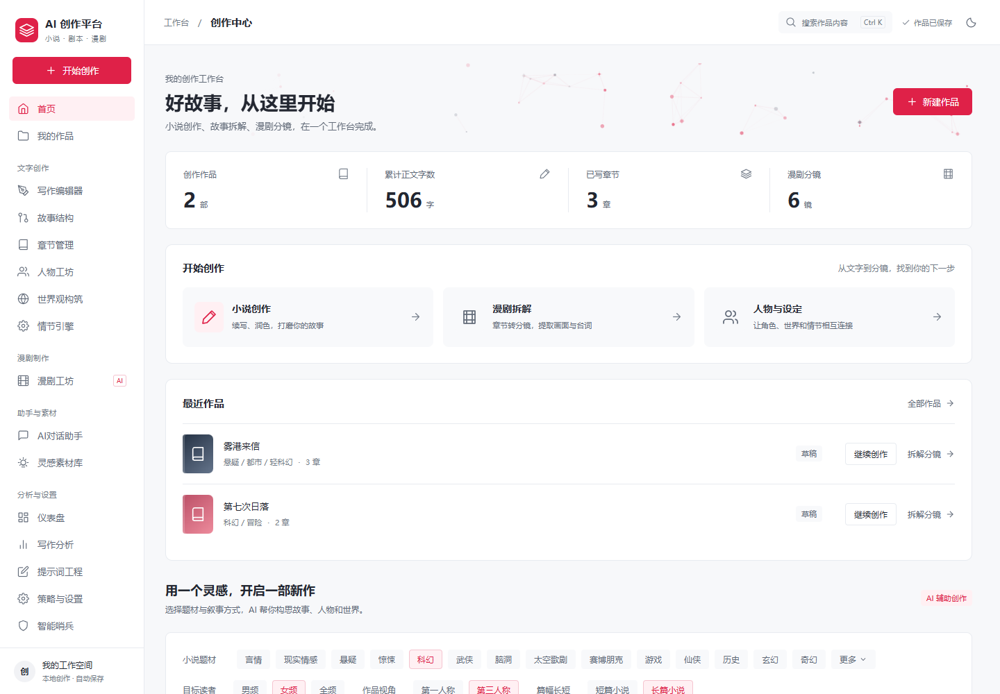
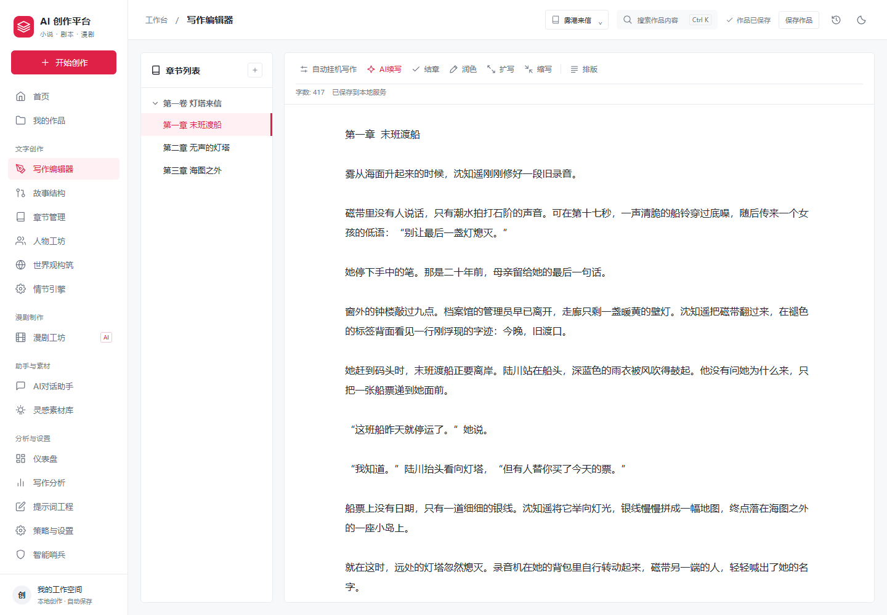
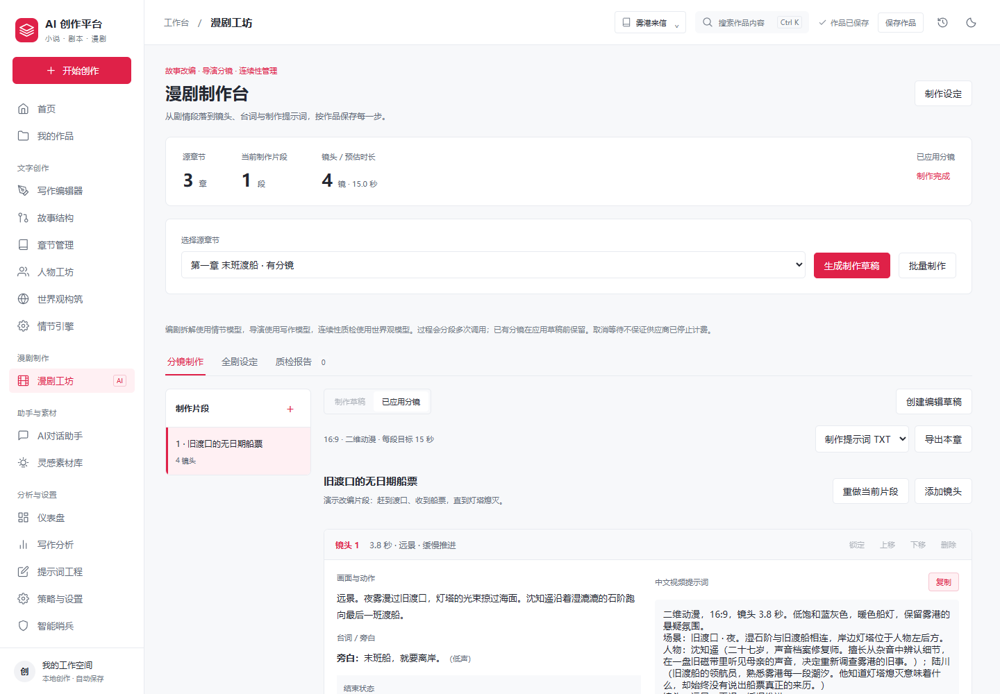
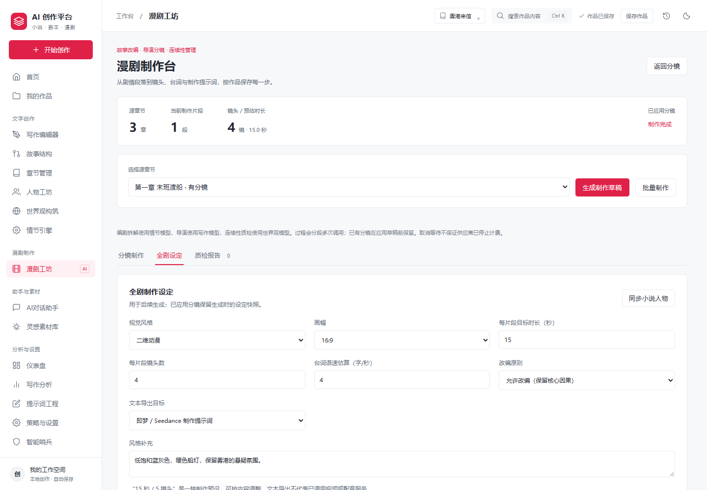
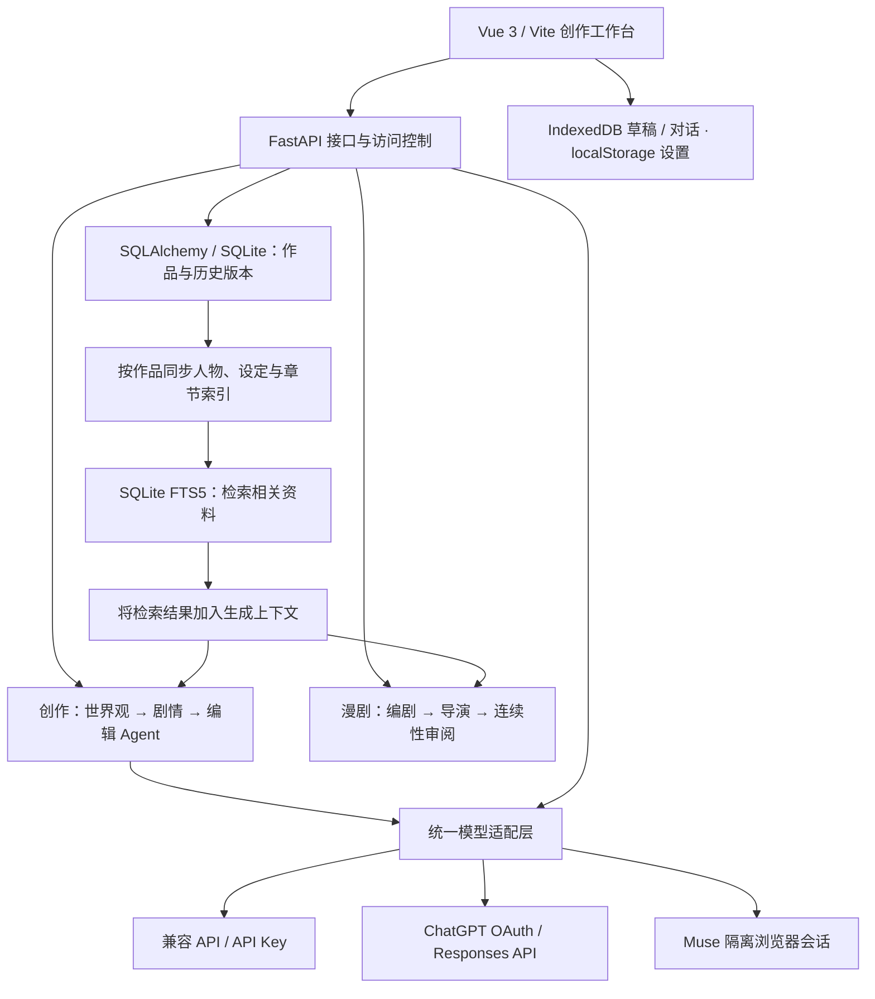

<div align="center">
  
  <h1>AI 创作平台</h1>
  <p><strong>AI Creation Studio</strong></p>
  <p>从文字创作、故事拆解，到 AI 漫剧分镜。</p>
  <p>Vue 3 · FastAPI · SQLite FTS5 / RAG · Multi-Agent · MIT</p>
  <p><a href="#界面预览">界面预览</a> · <a href="#技术架构">技术架构</a> · <a href="#快速开始">快速开始</a> · <a href="docs/README.md">使用文档</a> · <a href="CONTRIBUTING.md">参与贡献</a></p>
</div>

---

AI 创作平台是一个可在本机运行的创作工作台，将写作编辑、人物设定、故事结构和漫剧分镜放在同一套流程中。以 **SQLite 作品存储、FTS5 检索式 RAG 和多 Agent 分工**支持故事创作，作品保存在自己的设备上，可使用 API Key，也可连接受支持的平台账号。

## 界面预览

以下截图来自当前版本的实际界面，使用虚构演示作品和示例分镜，不含私人作品或账号信息。

**创作首页**：集中查看作品、创作统计与写作、人物设定、漫剧拆解入口。



**写作编辑器**：按章节组织正文，提供续写、润色、扩写与保存入口。



**漫剧制作台**：全剧设定、编剧拆解、导演分镜与连续性质检，支持制作草稿、局部重做和四类资料导出。



<details>
<summary>查看全剧制作设定</summary>



</details>

截图使用说明与复现方式见 [截图目录](docs/screenshots/README.md)。

## 主要功能

| 创作环节 | 能力 |
| --- | --- |
| 文字创作 | 作品与章节管理、AI 续写与润色、大纲预览和断点续传 |
| 故事构建 | 人物档案、世界观设定、时间线、剧情节点与作品内检索 |
| 漫剧改编 | 全剧设定、三角色拆解与质检、可恢复草稿、局部重做、TXT / JSON / CSV / SRT 导出 |
| 创作助手 | 引用当前作品资料对话，按作品保存聊天记录 |
| 数据管理 | 自动保存、本地草稿恢复、正文历史版本与 TXT 导出 |
| 模型接入 | 兼容 Chat Completions 的 API、ChatGPT 官方 OAuth、Muse 网页会话及用量展示 |

当前为单用户自托管版本。漫剧功能输出分镜脚本，尚不生成视频成片；Muse 使用隔离浏览器会话，并非官方 OAuth。详细支持范围见 [账号接入](docs/accounts.md)。

## 技术架构

**Vue 3 前端 + FastAPI 后端 + SQLite / SQLAlchemy 持久化 + FTS5 检索式 RAG + 多 Agent 固定流程编排。**



| 层次 | 当前实现 |
| --- | --- |
| 前端 | Vue 3 + Vite，负责编辑器、作品管理与分镜界面 |
| 业务存储 | SQLAlchemy + SQLite，保存作品、人物设定、漫剧制作设定 / 草稿与正文历史版本 |
| RAG 记忆 | SQLite FTS5 检索当前作品的相关资料，再放入后端生成上下文；中文查询支持子串回退 |
| Agent 分工 | 创作使用世界观、情节、编辑角色；漫剧另有编剧、导演、连续性审阅三个角色，分阶段保存 |
| 生成传输 | SSE 增量返回正文或大纲进度 |
| 浏览器存储 | IndexedDB 保存草稿和对话，localStorage 保存设置及既有模型配置 |

目前采用全文检索式 RAG，未接入向量数据库。多 Agent 采用固定顺序协作，可绑定同一模型或不同模型；部分单项写作功能直接组织上下文并经过模型代理，不经过整条 Agent 流水线。实现细节见 [项目架构](docs/architecture.md)。

## 快速开始

需要 **Node.js 24+** 和 **Python 3.11+**。

```bash
git clone https://github.com/fdehub/ai-creation-studio.git
cd ai-creation-studio
```

**Windows**

双击 `start_project.bat`，或在 PowerShell 中运行：

```powershell
.\start_project.bat
```

首次启动会安装依赖。启动后打开 [http://127.0.0.1:5273](http://127.0.0.1:5273)。

<details>
<summary><strong>macOS / Linux</strong></summary>

```bash
python3 -m venv .venv
.venv/bin/python -m pip install -r backend/requirements.txt
npm ci
.venv/bin/python backend/launch.py
```

</details>

进入 **策略与设置 → AI 引擎策略**，配置服务地址、模型与 Key，或连接平台账号，再选择负责写作、情节和世界观的模型。无需配置模型也可以先创建空白作品。

首次配置第三方模型服务，请参阅 [模型与运行配置](docs/configuration.md)。已有安装升级时，先备份数据，再重新安装 Python 和 npm 依赖。

## 文档

- [文档导航](docs/README.md)：找到适合使用者和开发者的说明。
- [模型与运行配置](docs/configuration.md)：服务地址、访问控制与部署参数。
- [账号接入](docs/accounts.md)：ChatGPT、Muse 登录与额度读取。
- [漫剧制作](docs/comic-production.md)：全剧设定、三角色流程、断点恢复、分镜编辑与导出。
- [保存与备份](docs/data-and-backups.md)：草稿、历史版本及数据迁移。
- [开发指南](docs/development.md)：本地开发、测试与构建。
- [发布指南](docs/releasing.md)：源码打包与发布检查。

## 项目结构

```text
backend/       FastAPI 接口、数据存储与模型适配
src/           Vue 界面与前端业务逻辑
public/        直接提供给浏览器的静态资源
scripts/       构建与发布辅助脚本
tests/         前端与浏览器测试
docs/          使用、开发与维护文档
third-party/   第三方版权与许可声明
.github/       GitHub 配置与工作流模板
```

架构和目录职责见 [项目架构](docs/architecture.md)。

## 许可与贡献

项目代码采用 [MIT 许可证](LICENSE)，第三方代码遵守 [各自的许可声明](third-party/README.md)。欢迎提交问题与改进，参与前请阅读 [贡献指南](CONTRIBUTING.md)；安全问题请按 [安全说明](SECURITY.md)报告。
