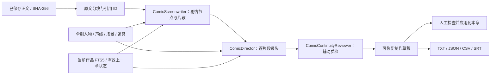

# 项目架构

AI 创作平台采用 Vue 前端与 FastAPI 后端，在本机以两个进程运行。它面向一个可信用户，不包含租户系统或多人协作服务。

核心组合是 **SQLite 业务存储 + FTS5 检索式 RAG + 多 Agent 固定流程编排**。

## 技术组成

| 层次 | 实现 |
| --- | --- |
| 界面 | Vue 3、Vite、响应式作品状态 |
| API | FastAPI、Pydantic、应用访问令牌、SSE 增量返回 |
| 持久化 | SQLAlchemy / SQLite，作品与最近 20 个正文历史版本 |
| 记忆检索 | 独立 `memory.db` 中的 SQLite FTS5，按作品隔离 |
| 创作编排 | 创作的世界观 / 剧情 / 编辑角色，以及漫剧的编剧 / 导演 / 连续性审阅角色；固定流程调用 |
| 模型适配 | Chat Completions 代理、ChatGPT OAuth / Responses、Muse 浏览器会话 |
| 浏览器数据 | IndexedDB 草稿与对话、localStorage 设置与既有模型配置 |

## SQL 与 RAG 的分工

作品正文、章节、人物和设定首先保存为 SQLite 业务数据。保存、恢复或开始相关生成流程时，后端将已提交资料同步为按作品隔离的检索文档。

`backend/retrieval.py` 使用 FTS5 查询相关文档；中文连续文本未命中时使用限定作品范围的子串回退，最多返回 5 条结果。编辑、大纲等后端流程将检索片段和当前任务资料一起送入模型，形成检索增强生成。

当前没有 embedding、向量索引或语义重排，也没有接入 ChromaDB / Elasticsearch。`search_type` 参数是兼容接口，实际执行的是同一套 SQLite 检索策略。前端对话和部分单项工具还会直接选择章节、人物等作为上下文，这与后端 FTS 检索路径分开。

## 多 Agent 的实际工作方式


主要流水线由 `backend/main.py` 编排，角色实现位于 `backend/agents.py`。每个角色具有自己的任务提示词，并可绑定独立模型配置；同一模型也能承担多个角色。

这是一套固定顺序的多角色创作流程，不包含自主规划、Agent 间自由讨论或动态任务调度。前端的单项续写、润色和人物生成可直接通过模型代理请求，不会自动运行整条创作流水线。漫剧使用独立的三阶段制作流程。

## 漫剧制作流程



`backend/comic_service.py` 为三类角色组织有界上下文；角色分别使用情节、写作、世界观的现有模型配置。`backend/comic_schema.py` 校验制作结构，`src/comic_production.js` 编排分阶段请求、断点恢复、草稿应用和导出，`ComicStudio.vue` 提供编辑工作区。

作品 `comicProduction` 保存全剧设定；章节 `comicDraft` 保存制作进度，`comicPlan` 和 `comicShots` 保存已应用版本。每个阶段成功后保存，生成不直接覆盖应用版本。正文哈希、制作基线与任务归属检查阻止过期结果覆盖编辑。旧数据库先备份再增加字段，分镜元数据更新不占用正文历史版本。

检索索引包含全剧资料及正文仍一致的已完成章节结束状态，排除未完成草稿和过期结束状态。当前使用文本模型；参考图没有自动识别，声线没有绑定配音服务，视频导出目标仅选择文本格式。详细操作与限制见[漫剧制作](comic-production.md)。

## 模块职责

| 目录 | 职责 | 约定 |
| --- | --- | --- |
| `src/` | Vue 页面、编辑器、作品状态、浏览器草稿与聊天记录 | 前端源码，使用 Vite 的 `src` 目录约定 |
| `public/` | 网站图标等静态资源 | 文件直接提供给浏览器，不放配置或私有数据 |
| `backend/` | API、SQLite 作品存储、检索、模型代理与账号适配 | Python 后端；后端测试位于 `backend/tests/` |
| `tests/` | 前端行为和端到端浏览器测试 | 临时数据、模拟模型，不调用真实账号 |
| `scripts/` | 源码打包等维护脚本 | 与应用运行逻辑分开 |
| `docs/` | 使用、开发、发布及审查文档 | 文件名使用小写短横线；审查记录集中在 `docs/reviews/` |
| `third-party/` | 第三方版权与许可声明 | 保留原版权主体及许可全文 |
| `.github/` | GitHub 专用配置 | 当前只发布工作流模板，未启用自动 CI |

后端、前端源码与测试目录保留常见的工程命名。文档和声明目录统一使用小写短横线，避免混合下划线、缩写和报告文件名。

## 请求与数据流

```text
浏览器中的 Vue 工作台
  ├─ IndexedDB：未提交草稿、按作品保存的对话
  └─ /api → FastAPI
       ├─ SQLite：作品、正文历史版本、作品内检索
       ├─ uploads/：素材图片
       └─ 模型适配
            ├─ API Key → 允许列表中的模型服务
            ├─ ChatGPT → OAuth / Responses API
            └─ Muse → 本机隔离浏览器
```

开发前端默认监听 `127.0.0.1:5273`，通过代理访问 `127.0.0.1:8100` 的后端。生产构建输出到 `dist/`；Vite 开发服务器不作为公网生产服务。

## 兼容约定

浏览器存储键、`NOVEL_*` 环境变量和已有数据库文件名保留兼容，不随产品名称或文档整理改动。目录整理不迁移现有作品、Key、账号会话或用户配置。

运行参数见 [模型与运行配置](configuration.md)，存储边界见 [保存与备份](data-and-backups.md)。
